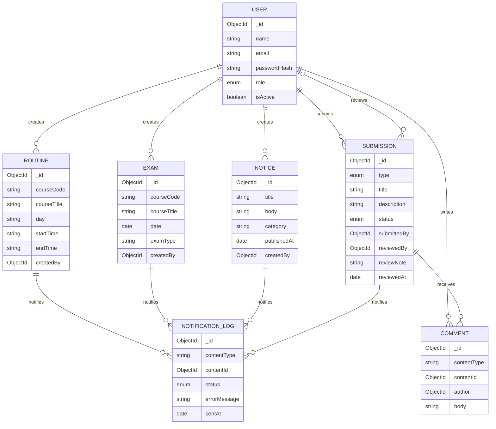

# Suchi System Design Architecture

This diagram describes the current Suchi MVP architecture: a browser application, a role-aware REST API, MongoDB persistence, and optional Telegram delivery. The backend is the authorization boundary; frontend route guards are only for navigation.

## System context and components

```mermaid
flowchart LR
    subgraph People[Authenticated users]
        Student[Student]
        CR[Class Representative]
        Admin[Admin]
    end

    subgraph Client[Browser]
        UI[React + Vite UI<br/>React Router and Tailwind]
        ClientAPI[API client<br/>fetch with credentials]
    end

    subgraph Server[Express application]
        Edge[HTTP middleware<br/>Helmet, CORS, JSON, cookies]
        Auth[Authentication<br/>JWT in HttpOnly cookie]
        Access[Backend authorization<br/>role, ownership, validation]
        Routes[REST modules<br/>auth, users, academics<br/>submissions, comments, notifications]
        Notify[Telegram notification service]
    end

    DB[(MongoDB<br/>Mongoose models)]
    Telegram[Telegram Bot API<br/>optional integration]

    Student & CR & Admin --> UI
    UI --> ClientAPI
    ClientAPI -->|HTTPS / JSON / session cookie| Edge
    Edge --> Auth --> Access --> Routes
    Routes <-->|read and write| DB
    Routes -->|published or updated content| Notify
    Notify -->|message; only after persistence| Telegram
    Notify -->|delivery outcome| DB
    ClientAPI -.->|Vite proxies /api in development| Edge
```



In production, serve the frontend and API over HTTPS and configure the allowed client origin. The browser sends the session cookie with API requests. Public registration always creates a student; Admin and CR permissions are assigned and enforced by the backend.

## Request and approval flows

```mermaid
sequenceDiagram
    actor User
    participant Browser as React browser app
    participant API as Express REST API
    participant Guard as Auth, role, ownership and validation checks
    participant DB as MongoDB
    participant TG as Telegram Bot API

    User->>Browser: Sign in or perform an action
    Browser->>API: JSON request + HttpOnly session cookie
    API->>Guard: Authenticate and authorize request
    Guard-->>API: Valid identity and permission
    API->>DB: Read or persist requested data
    DB-->>API: Result
    API-->>Browser: JSON response
    Browser-->>User: Updated page or status

    User->>Browser: Student submits event, news, or suggestion
    Browser->>API: POST /submissions
    API->>Guard: Require authenticated user; validate payload
    API->>DB: Save Submission(status = pending)
    DB-->>API: Saved pending submission
    API-->>Browser: Submission status

    User->>Browser: Admin/CR reviews and approves
    Browser->>API: PATCH /submissions/:id/review
    API->>Guard: Require Admin/CR; validate decision
    API->>DB: Update same Submission to approved or rejected
    DB-->>API: Updated record
    opt Approved and Telegram configured
        API->>TG: Send published update after database save
        TG-->>API: Delivery result
        API->>DB: Save NotificationLog
    end
    API-->>Browser: Review result
```

Pending and rejected submissions are excluded from the published feed. Approval changes the status on the existing `Submission` record; the system does not copy it into a second published-content collection. Telegram is auxiliary: delivery failure does not undo the saved publication, and the outcome is recorded for authorized users.

## Data model and persistence



`Submission.status` is `pending`, `approved`, or `rejected`; approved submissions power the published contribution feed. Comments reference published content by type and ID. Notification logs capture Telegram delivery status, including disabled or failed delivery.

## Trust and configuration boundaries

- **Browser:** presentation and navigation only. A hidden button or guarded route does not grant security.
- **Express API:** validates input, verifies the session, checks role and ownership, and controls access to every protected operation.
- **MongoDB:** stores users, academic records, submissions, comments, and notification logs. Passwords are stored as bcrypt hashes.
- **Secrets:** `MONGODB_URI`, `JWT_SECRET`, `TELEGRAM_BOT_TOKEN`, and other private configuration stay on the backend. Telegram credentials are optional and are never sent to the browser.
- **External delivery:** the Telegram Bot API is called only for published or updated content. Suchi and MongoDB remain the source of truth.

See [architecture.md](architecture.md), [api.md](api.md), and [the project README](../README.md) for detailed requirements, endpoint access, and local setup.
