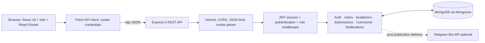
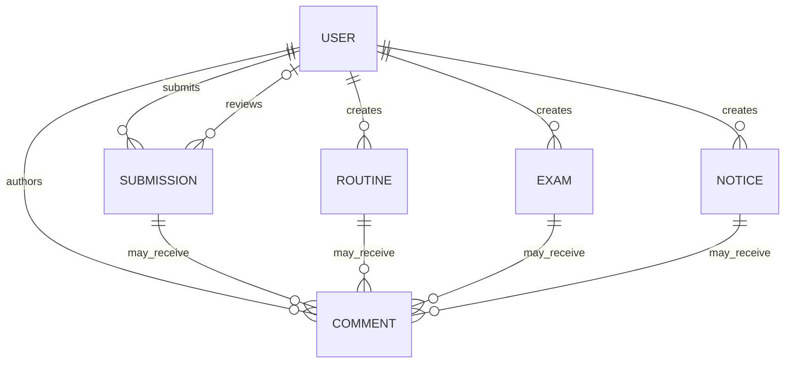

# Suchi — Technical Presentation Brief

> **Purpose:** A presentation-ready, implementation-grounded reference for explaining the Suchi project from product problem through architecture, data, security, API, operation, and future scope.
>
> **Product tagline:** *Light up every update.*

## 1. Executive summary

Suchi is an authenticated academic information and communication web application. It centralizes class routines, exam schedules, notices, and approved student contributions in one workspace. Students can propose events, news, and suggestions; an Admin or Class Representative (CR) reviews those submissions before they appear in the shared feed. Comments support discussion, and optional Telegram messages help distribute published updates.

The repository implements a JavaScript monorepo with a React/Vite browser client and an Express/Mongoose API backed by MongoDB. The API is the authorization boundary. Sessions use a signed JWT in an HttpOnly cookie, and role checks are enforced on protected endpoints.

### One-sentence pitch

> Suchi gives a class one authenticated source for academic updates, with role-controlled publishing and a review workflow for student contributions.

## 2. The problem and proposed value

Academic updates often arrive through separate chat groups, private messages, and documents. This makes it harder to find the latest routine, confirm an exam detail, distinguish official updates from suggestions, and know whether a student proposal has been reviewed.

Suchi addresses that workflow by:

- Keeping routines, exams, notices, and approved contributions in one web workspace.
- Restricting academic publishing and review actions to Admins and CRs.
- Letting students contribute without publishing unreviewed content to everyone.
- Showing submitters their own statuses and reviewer notes.
- Offering optional Telegram delivery while keeping MongoDB as the source of truth.

## 3. Users and implemented permissions

There are three roles: `admin`, `cr`, and `student`.

| Capability | Admin | CR | Student |
| --- | --- | --- | --- |
| Read academic collections and approved submissions | Yes | Yes | Yes |
| Create, edit, delete routines, exams, and notices | Yes | Yes | No |
| Submit an event, news item, or suggestion | Yes; published immediately | Yes; published immediately | Yes; starts pending |
| Review pending student submissions | Yes | Yes | No |
| View own submission history | Yes | Yes | Yes |
| Manage users, roles, account status, and passwords | Yes | No | No |
| Comment on published content | Yes | Yes | Yes |
| Delete own comment | Yes | Yes | Yes |
| Delete another user's comment | Yes | Yes (moderator) | No |
| View Telegram delivery logs | Yes | Yes | No |

Public registration validates only name, email, and password, and the server assigns `student`. It does not accept a user-selected role. The initial Admin is created by a seed script; an Admin can later assign CR or Admin roles through the user-management API.

## 4. Feature inventory

### Authentication and account

- Student registration, login, logout, and current-session lookup.
- Account name and password changes after confirming the current password.
- Passwords stored as bcrypt hashes; the model excludes the hash from normal reads.
- Admin user listing/detail, role changes, active/inactive status, and password reset.
- A guard prevents deactivating or demoting the last active Admin.

### Academic information

- **Routines:** course, course code, teacher, weekday, start/end time, room, topic, and optional resource URL.
- **Exams:** course, course code, exam type, date, start time, room, topics, optional suggestion, and resource URL.
- **Notices:** title, body, category, author, and publication timestamp.
- Authenticated users can read the collections. Admins and CRs can create, edit, and delete them.

### Submissions and publishing

- Students can submit `event`, `news`, or `suggestion` records.
- Student submissions start in `pending`; they remain hidden from the published feed.
- Admins and CRs can approve or reject with an optional note.
- Approval changes the status of the same Submission record; the application does not copy it into a second published-content collection.
- Submitters can inspect their own statuses and notes. Withdrawal is restricted to pending items. **Implementation note:** the current update route checks ownership but does not check that the item is pending, so an owner can currently edit an already reviewed item; this differs from the intended workflow and should be corrected before presenting “edit pending only” as a guarantee.
- Admin/CR submissions are marked approved at creation.

### Comments and notifications

- Authenticated users can read and add comments to routines, exams, notices, and approved submissions.
- Comment deletion is available to the comment author, Admin, or CR.
- Telegram delivery is optional. When configured, publication/update/approval attempts send a message and save a sent/failed NotificationLog. Pending student submissions do not trigger Telegram.
- A Telegram failure does not undo the saved content. If Telegram environment values are absent, delivery is disabled.

## 5. System architecture



### Request lifecycle

1. A user interacts with a React route. The frontend uses `fetch` through a small API helper and includes credentials.
2. In development, Vite proxies `/api` calls to the Express server. In deployment, the browser must reach the API at the configured origin and CORS must allow the client origin.
3. Express applies Helmet, credentialed CORS, a 32 KB JSON body limit, and cookie parsing.
4. The route validates request data, then authentication middleware verifies the session cookie and reloads the active user from MongoDB.
5. Role and ownership checks are applied in API handlers/middleware. Mongoose reads or writes the relevant collection.
6. For publishable updates, Telegram delivery is attempted after persistence. The route returns JSON; successful deletes return HTTP 204.

### Architectural choices

- **Feature-oriented modules:** backend routes/models/services are grouped by domain.
- **Single API service:** frontend and backend are separately runnable workspaces; the API is a REST-style JSON service.
- **MongoDB document model:** Mongoose schemas hold domain records, timestamps, references, validation, and query indexes.
- **Server-side authorization:** React route guards shape navigation, while API middleware/handlers enforce access.
- **One submission lifecycle:** pending, approved, and rejected states live on the same Submission document.
- **Optional integration:** Telegram is ancillary and is not required to use the application.

## 6. Frontend implementation

### Stack

- React 19 and JSX, built and served in development by Vite 7.
- React Router 7 for page routing.
- Tailwind CSS 4 through its Vite plugin, with project styles and theme tokens in `frontend/src/styles.css`.
- Native `fetch` wrapper in `frontend/src/lib/api.js`; no Axios dependency.
- No separate global state library; authentication is shared with a React context/provider.

### Main structure

```text
frontend/src/
├── AppShell.jsx                 # route map and route guards
├── main.jsx                     # React, StrictMode, BrowserRouter bootstrap
├── lib/api.js                   # JSON fetch client with cookie credentials
├── layouts/WorkspaceLayout.jsx
├── features/
│   ├── auth/                    # login, registration, account, session context
│   ├── dashboard/               # role-aware overview and schedule utilities
│   ├── academics/               # routine, exam, notice lists and details
│   ├── submissions/             # events feed, contribute, my items, review queue
│   ├── comments/                # published-content discussion
│   ├── users/                   # Admin user operations
│   └── notifications/           # delivery log view
└── components/ConfirmDialog.jsx
```

### User experience notes

- Public routes: `/login` and `/register`.
- Authenticated pages include dashboard, account, routines, exams, notices, events, contribution form, own submissions, and comments.
- Admin/CR routes include review queue and notification logs; Admin routes include user management.
- Dashboard combines academic collections, upcoming classes/exams, published contributions, and role-specific review/status information.
- Schedule utilities calculate upcoming weekly classes and future exams in the browser.
- The visual theme uses a light neutral background, deep green and rust accents, Manrope/DM Sans typography, and Bengali font support.

## 7. Backend implementation

### Stack

- Node.js with ES modules and Express 5.
- MongoDB and Mongoose 8.
- Zod 4 for request validation.
- bcryptjs for password hashing; jsonwebtoken for signed sessions.
- cookie-parser, CORS, Helmet, dotenv, and express-rate-limit.

### Module structure

```text
backend/src/
├── app.js                       # middleware and route registration
├── server.js                    # Mongo connection and HTTP startup
├── config/                      # env loading and Mongo connection/health state
├── middleware/auth.js           # active-user authentication and role gate
├── routes/health.js             # database-aware health endpoint
├── modules/
│   ├── auth/                    # auth endpoints and JWT/cookie helpers
│   ├── users/                   # User schema and Admin user routes
│   ├── academics/               # routines, exams, notices, Zod schemas
│   ├── submissions/             # submission workflow
│   ├── comments/                # published content comments
│   └── notifications/           # Telegram sender and delivery log
└── scripts/                     # seedAdmin and seedDemo
```

Startup connects to MongoDB before listening. A missing or unreachable `MONGODB_URI` produces a clear startup error. `GET /api/health` returns `200` with connected status or `503` when the database is unavailable.

## 8. Data model and relationships

All models use Mongoose timestamps (`createdAt`, `updatedAt`) unless specifically noted. MongoDB creates collections from the models as records are inserted.

| Collection / model | Main fields | Relationship and purpose |
| --- | --- | --- |
| `User` | name, normalized unique email, passwordHash, role, isActive | Identity and authorization. Other records refer to user IDs. |
| `Routine` | courseTitle/code, teacher, day, start/end time, room, topic, resourceUrl, createdBy | Class schedule entry; `createdBy` references User. Indexes support course and day/time lookup. |
| `Exam` | courseTitle/code, examType, date, startTime, room, topics, suggestion, resourceUrl, createdBy | Exam schedule; `createdBy` references User. Indexes support course/date and date lookup. |
| `Notice` | title, body, category, createdBy, publishedAt | Published academic notice; `createdBy` references User. Indexed by publication date. |
| `Submission` | title, type, description, eventDate, location, resourceUrl, submittedBy, status, reviewedBy, reviewedAt, reviewNote | Student proposal or approved feed item; submitter/reviewer reference User. Indexed by status/date and submitter/date. |
| `Comment` | contentType, contentId, author, body | Polymorphic association to routine, exam, notice, or submission; author references User. Indexed by content and date. |
| `NotificationLog` | contentType, contentId, channel, status, errorMessage, sentAt | Telegram delivery outcome for content; indexed by creation date. |

### Relationship sketch



Comments use a `contentType` plus `contentId` pair rather than a separate foreign-key field for each content model. Notification logs similarly identify the target with type and ID.

## 9. API overview

Base path: `/api`. Responses are JSON, except successful deletes return `204 No Content`. Browser sessions are sent as cookies.

| Area | Routes | Access summary |
| --- | --- | --- |
| Auth | `POST /auth/register`, `POST /auth/login`, `POST /auth/logout`, `GET /auth/me`, `PATCH /auth/account` | Register/login/logout are public; session and account operations authenticate the caller. |
| Users | `GET /users`, `GET /users/:id`, `PATCH /users/:id/role`, `PATCH /users/:id/status`, `PATCH /users/:id/password` | Admin only. |
| Routines | `GET /routines`, `POST /routines`, `PATCH /routines/:id`, `DELETE /routines/:id` | Reads require login; writes require Admin/CR. |
| Exams | `GET /exams`, `POST /exams`, `PATCH /exams/:id`, `DELETE /exams/:id` | Reads require login; writes require Admin/CR. |
| Notices | `GET /notices`, `POST /notices`, `PATCH /notices/:id`, `DELETE /notices/:id` | Reads require login; writes require Admin/CR. |
| Submissions | `POST /submissions`, `GET /submissions/mine`, `GET /submissions/pending`, `GET /submissions/published`, `PATCH /submissions/:id`, `DELETE /submissions/:id`, `PATCH /submissions/:id/review` | Authenticated; ownership and Admin/CR review rules apply. |
| Comments | `GET/POST /content/:contentType/:contentId/comments`, `DELETE /comments/:id` | Authenticated; content must be published; deletion checks owner/moderator. |
| Notifications | `GET /notifications` | Admin/CR. |
| Health | `GET /health` | Public operational check under `/api`. |

### Common response codes

- `200`: successful read/update/action.
- `201`: created record.
- `204`: successful deletion.
- `400`: invalid body or identifier.
- `401`: missing/expired/invalid session or failed authentication.
- `403`: insufficient role or ownership.
- `404`: missing record or content unavailable to caller.
- `409`: duplicate account, last-admin protection, or invalid workflow transition.
- `503`: health endpoint reports database unavailable.

See [api.md](api.md) for the compact endpoint reference.

## 10. Security and validation

### Implemented safeguards

- Password hashing uses bcryptjs with cost factor 12. Hash fields are not selected by default and are not returned by `publicUser`.
- Session JWT is signed with a 7-day expiry and stored in an HttpOnly cookie named `suchi_session`; cookie is SameSite=Lax and Secure in production.
- Production requires a non-placeholder `JWT_SECRET` of at least 32 characters. Development can use an ephemeral generated secret if unset; sessions then expire when the backend restarts.
- Every authenticated request resolves the active user from MongoDB; inactive or missing accounts lose session access.
- Public registration assigns `student` on the server.
- Route validation uses Zod and Mongoose schema constraints. Resource links are restricted to HTTP or HTTPS by validation.
- Login and registration share a rate limit of 20 attempts per 15 minutes.
- Helmet is enabled, CORS is limited to configured `CLIENT_ORIGIN` with credentials, and JSON request bodies are capped at 32 KB.
- Ownership checks limit submission edits; withdrawal is restricted to pending records. The current update route does not enforce pending-only edits, so that workflow guard is a known implementation gap. Pending records are isolated from the published feed.
- Last-active-Admin protection prevents accidental removal of all active Admin access.
- Secrets are loaded from `backend/.env`; `.gitignore` excludes environment files while retaining `.env.example`.

### Presentation caveat

This is an MVP foundation, not a claim of a completed production security review. The repository does not implement file uploads, a separate audit/activity-log subsystem, automated backups, or a deployment-specific threat model. The current session cookie and CORS setup should be reviewed alongside deployment topology and CSRF policy before internet-facing production use.

## 11. Notifications and failure behavior

Telegram integration uses the Bot API `sendMessage` endpoint from the backend. The bot token and chat ID are environment-only values. Messages include the content type/title and a URL built from `PUBLIC_APP_URL` (falling back to `CLIENT_ORIGIN`). A five-second request timeout bounds the attempt.

Content is persisted before notification is attempted. A delivery result is recorded as `sent` or `failed` in `NotificationLog`; the caller gets a delivery status. If Telegram is unconfigured, the response indicates that it is disabled and no external delivery is attempted. Notification failure does not roll back content publication.

## 12. Developer setup and operation

### Prerequisites

- Node.js 20.19 or newer.
- npm 10 or newer.
- Local MongoDB or a reachable MongoDB connection URI.

### Local setup

From the repository root:

```bash
npm install
```

Create `backend/.env` from `backend/.env.example`, then configure `MONGODB_URI`, a random `JWT_SECRET` of at least 32 characters, and initial Admin fields. Start MongoDB and create the Admin once:

```bash
npm run seed:admin --workspace backend
```

Optional labeled sample data:

```bash
npm run seed:demo --workspace backend
```

Run both workspaces together with `npm run dev`, or run these separately:

```bash
npm run dev:backend
npm run dev:frontend
```

Default local addresses are frontend `http://localhost:5173`, API `http://localhost:4000`, and health endpoint `http://localhost:4000/api/health`. Vite proxies `/api` to port 4000.

### Environment variables

| Variable | Purpose | Required / default |
| --- | --- | --- |
| `PORT` | API listener port | Optional; `4000` |
| `MONGODB_URI` | Mongo connection URI | Required to start server |
| `CLIENT_ORIGIN` | Allowed frontend origin for credentialed CORS | Optional; `http://localhost:5173` |
| `JWT_SECRET` | JWT signing secret | Required as a strong non-placeholder value in production; dev can generate a temporary secret |
| `ADMIN_NAME` | Name for initial Admin seed | Required only for seed command |
| `ADMIN_EMAIL` | Email for initial Admin seed | Required only for seed command |
| `ADMIN_PASSWORD` | Initial Admin password (12–72 bytes for seed) | Required only for seed command |
| `TELEGRAM_BOT_TOKEN` | Telegram bot token | Optional; integration disabled when missing |
| `TELEGRAM_CHAT_ID` | Target Telegram chat | Optional; integration disabled when missing |
| `PUBLIC_APP_URL` | Public base URL for Telegram links | Optional; fallback to `CLIENT_ORIGIN` or local URL |

Do not copy actual secret values into slides, screenshots, or source control. The `.env` file is local configuration and must remain private.

## 13. Quality and test notes

Repository scripts include:

```bash
npm run lint
npm test
npm run build
```

The repository includes Node test files for authentication utilities, academic schemas, and dashboard schedule utilities. Describe these as present tests, not as proof that every user journey or security property has been exhaustively tested. Run the commands before a live demo and report the actual results from that run.

## 14. Current scope and honest limitations

### Implemented in the current code

- Role-based login and Admin-managed users.
- Routine, exam, and notice CRUD for Admin/CR, with authenticated reading.
- Student contribution, review queue, approval/rejection notes, and published feed.
- Comments on supported published records.
- Optional Telegram delivery with outcome logs.
- Demo-data seeding and health endpoint.

### Not implemented or not evidenced in the repository

- File upload/storage, attachments, or a media service.
- Automated reminders, cron processing, or Google Calendar integration.
- Multiple institutions/tenant isolation or native mobile applications.
- Private chat, analytics/recommendation engines, or a full audit log.
- Production deployment manifests, CI/CD pipeline, observability stack, and backup/restore procedures.
- Dedicated pagination/filtering API for growing collections; current list handlers use bounded results in several areas.
- A pending-status guard on the submission update route; currently only ownership is checked for edits, despite the intended pending-only rule.

The system is positioned as a small academic-class MVP. For production, likely next work includes deployment configuration, backup/restore, monitoring, a security review, pagination, and clearly defined operational ownership.

## 15. Suggested presentation flow (10–12 slides)

1. **Title:** Suchi — *Light up every update.* Name, course/team, date.
2. **Problem:** scattered updates, unclear source of truth, unreviewed proposals.
3. **Solution and users:** centralized class workspace; Admin, CR, Student.
4. **Feature walkthrough:** routine/exam/notice, contribution, review, comments.
5. **Approval workflow:** Student → Pending → Admin/CR review → Approved feed or Rejected with note.
6. **Architecture:** browser → API → MongoDB, with optional Telegram side path.
7. **Technology stack:** React/Vite/Tailwind; Express/Node; MongoDB/Mongoose; JWT cookie; Zod.
8. **Data model:** User, Routine, Exam, Notice, Submission, Comment, NotificationLog and key references.
9. **Security:** server-side RBAC, bcrypt, HttpOnly cookie, validation, rate limiting, CORS/Helmet.
10. **Demo:** Admin assigns CR; CR posts notice; student submits; reviewer rejects/approves; show feed and logs.
11. **Scope and limitations:** what works today and what belongs in future work.
12. **Conclusion / Q&A:** centralized verified updates; next steps for deployment readiness.

### Demo sequence

1. Check `/api/health` and sign in as Admin.
2. Show Users and assign a student account the CR role.
3. Sign in as CR and publish or edit an academic item.
4. Sign in as Student; view academic content and submit an event or suggestion.
5. Show that it appears in My items as pending and is absent from the published feed.
6. As CR, reject one item with a note; show that the submitter can read the note.
7. Approve another item; show it in the feed and open its comments.
8. If Telegram credentials are configured, show the delivery log; otherwise explain it is optional and disabled in this demo.

See [demo-script.md](demo-script.md) for the existing detailed walkthrough.

## 16. Likely technical questions and concise answers

**Why use MongoDB?** The application stores independent academic records and workflow documents with flexible fields, while Mongoose provides schemas, validation, timestamps, references, and indexes.

**How is the student feed protected from unreviewed content?** The API's published endpoint queries only `status: "approved"`; review actions change status after checking that the item is still pending.

**Why is there one Submission model for pending and approved content?** The content shape is shared across the contribution workflow. Updating status publishes the same record and avoids a second copy that could diverge.

**Where is authorization enforced?** In backend middleware and route-level ownership/role checks. Frontend guards only prevent inappropriate navigation and are not treated as the security boundary.

**What if Telegram is unavailable?** The saved content remains in MongoDB; the send attempt is bounded by a timeout and the delivery outcome is logged when possible.

**Can a student make themselves an Admin?** No. Registration assigns `student` server-side; user role changes are restricted to Admin endpoints.

**What happens if MongoDB is down?** The server cannot finish startup if its connection fails, and the health route reports database availability when the API is running.

## 17. Repository reference map

- Product/setup overview: [README.md](../README.md)
- Architecture and product design: [architecture.md](architecture.md)
- Endpoint reference: [api.md](api.md)
- Live walkthrough: [demo-script.md](demo-script.md)
- Frontend routes and bootstrap: `frontend/src/AppShell.jsx`, `frontend/src/main.jsx`
- Backend wiring and startup: `backend/src/app.js`, `backend/src/server.js`
- Authentication and roles: `backend/src/modules/auth/`, `backend/src/middleware/auth.js`
- Domain schemas and routes: `backend/src/modules/`
- Environment template: `backend/.env.example`